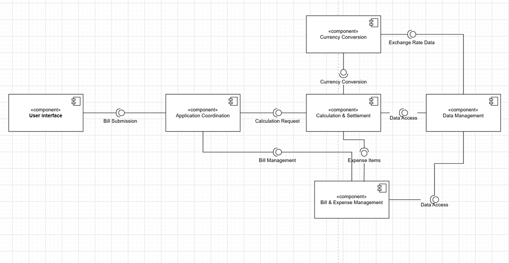
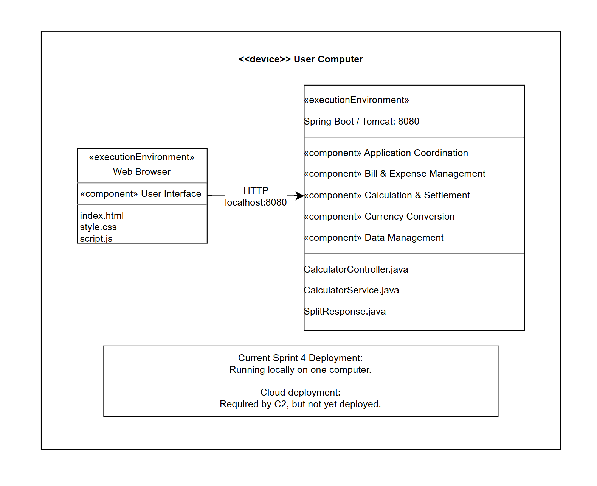
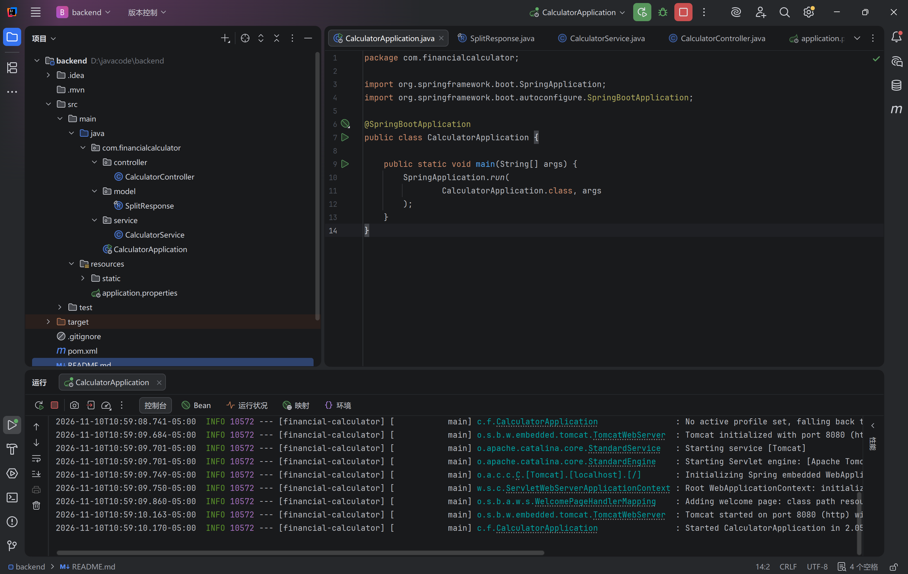
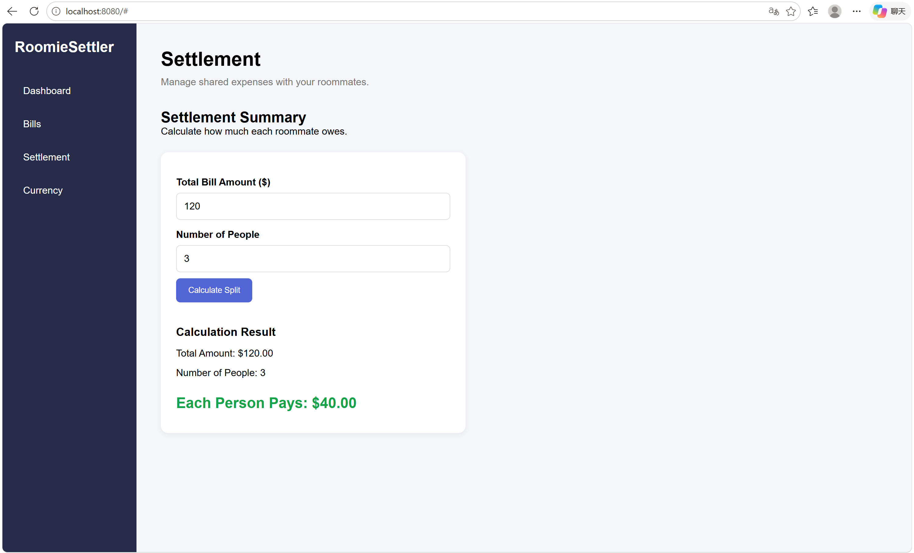

# RoomieSettler

## 1. Project Overview

RoomieSettler is a shared-expense application designed to help students track bills, divide expenses, and plan settlements. This Sprint 4 repository contains an initial locally running web application and a basic equal-split calculation API. It is a project skeleton, not a complete implementation of all planned features.

## 2. Tech Stack

| Area | Technology | Current use |
| --- | --- | --- |
| Frontend | HTML, CSS, JavaScript | Browser-based interface |
| Backend | Java 17, Spring Boot 3.5.6 | Local REST API and calculation logic |
| Build tool | Maven | Backend dependencies and execution |
| API | HTTP / REST (JSON) | Browser-to-backend communication |
| Database | Not implemented | Persistence is planned |
| Hosting | Local computer, port 8080 | Cloud deployment is planned, not active |

The team's design rationale for these choices is documented in the Sprint 4 report.

## 3. System Architecture

Sprint 3 selected a **modular architecture** with six subsystems:

1. **User Interface** — receives expense and participant input and displays results.
2. **Application Coordination** — coordinates user requests and business operations.
3. **Bill & Expense Management** — manages bills, expense items, and splitting rules.
4. **Calculation & Settlement** — calculates participant shares and settlement results.
5. **Currency Conversion** — applies exchange rates and currency rounding.
6. **Data Management** — stores expense, participant, and historical data.

### Sprint 3 subsystem/component diagram



### Sprint 4 deployment diagram



**Current deployment:** The web browser and Spring Boot/Tomcat backend run on one local computer. The browser communicates with the backend using HTTP at `localhost:8080`. The deployment diagram shows the intended placement of all six subsystems; **only the basic UI, request handling, and equal-split calculation are implemented so far**. The Bill & Expense Management, Currency Conversion, and Data Management business functions shown in the diagram are planned rather than fully deployed. Cloud deployment is also planned, not implemented.

## 4. Repository Structure and Subsystem Mapping

```text
RoomieSettler/
├── frontend/
│   ├── index.html
│   ├── style.css
│   └── script.js
├── backend/
│   ├── pom.xml
│   └── src/main/
│       ├── java/com/financialcalculator/
│       │   ├── CalculatorApplication.java
│       │   ├── controller/CalculatorController.java
│       │   ├── service/CalculatorService.java
│       │   └── model/SplitResponse.java
│       └── resources/
│           ├── application.properties
│           └── static/
├── docs/
│   ├── subsystem-diagram.png
│   ├── deployment-diagram.png
│   └── screenshots/
│       ├── backend-running.png
│       └── frontend-integration.png
└── README.md
```

| Sprint 3 subsystem | Current location / implementation | Status |
| --- | --- | --- |
| User Interface | `frontend/` and `backend/src/main/resources/static/` | Initial UI implemented |
| Application Coordination | `backend/src/main/java/com/financialcalculator/controller/` | Basic API request handling |
| Calculation & Settlement | `backend/src/main/java/com/financialcalculator/service/` and `model/` | Equal split only |
| Bill & Expense Management | Some UI elements; no separate business module | Planned |
| Currency Conversion | UI placeholder; no conversion service | Planned |
| Data Management | No persistent database or dedicated module | Planned |

The Java `controller`, `service`, and `model` packages are the current technical implementation structure. They are not six completed, independent subsystem modules. Additional modules/folders may be added as development proceeds.

## 5. How to Run Locally

### Prerequisites

- JDK 17
- Maven (available as the `mvn` command)
- Git
- A modern web browser

### Clone and start

```bash
git clone https://github.com/JudyJiang068/RoomieSettler.git
cd RoomieSettler/backend
mvn spring-boot:run
```

Wait for Spring Boot to start. The configured backend port is **8080**.

### Open the web application

Visit **http://localhost:8080/** in a browser. The Spring Boot `static/` resources serve the web interface. To avoid relative API path issues, use this address rather than opening `frontend/index.html` directly from the file system.

### Verify the calculation API

Open this URL in the browser:

`http://localhost:8080/api/calculator/split?amount=100&people=4`

Expected JSON response (field ordering may vary):

```json
{
  "totalAmount": 100,
  "numberOfPeople": 4,
  "eachPersonPays": 25.00
}
```

The endpoint rejects non-positive amounts and non-positive participant counts with an error response.

**Verification note:** These commands and expected outputs are based on the project source and configuration; each team member should confirm the application runs on their own machine. If the project is uploaded without flattening the nested backend folder, change the `cd` path accordingly.

## 6. Implemented Features and Limitations

### Currently implemented

- Basic browser UI with dashboard, bill, settlement, and currency-related sections
- UI action to add a bill name to the displayed list (not persistent)
- Equal bill-splitting calculation through a Spring Boot REST endpoint
- Basic input validation for the split calculation

### Not yet implemented

- Persistent storage of bills, expenses, or participants
- Full item-level assignment, taxes, and configurable splitting rules
- Complete debt simplification and settlement workflow
- Live exchange-rate retrieval and currency conversion
- Access control and complete integration of all six Sprint 3 subsystems
- Cloud deployment

The equal-split API rounds each person's share to two decimal places. It does not yet implement a remainder-allocation process to guarantee that rounded shares sum exactly to the receipt total for every input.

## 7. Running Evidence

Initial screenshots are stored at:

- [Backend running](docs/screenshots/backend-running.png)
- [Frontend integration](docs/screenshots/frontend-integration.png)





The Sprint 4 submission PDF separately records whether **each team member** cloned and ran the project on their own computer, including any problems encountered.

## 8. Security and Development Notes

Do not commit passwords, API keys, or other secrets. If environment variables are introduced later, commit a `.env.example` template without real values and ignore local `.env` files. No database credentials are required for the current skeleton.
